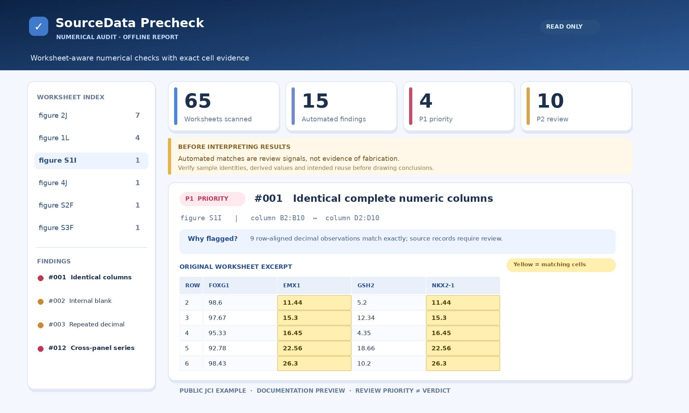
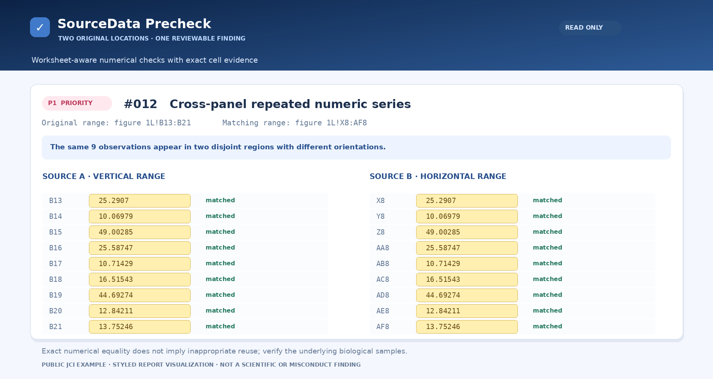

[README.md](https://github.com/user-attachments/files/34475829/README.md)
# SourceData_precheck
A scientific Source Data integrity audit skill for Excel, with conservative duplicate detection and statistical verification.
<div align="center">


# SourceData Precheck

**Trace every number. Review every warning.**

A privacy-first, read-only **Source Data integrity check** for `.xlsx`, `.xls`, `.csv` and `.tsv` — with a clear, interactive **offline HTML report**.

[](https://github.com/LolipopPip/SourceData_precheck/releases/latest)  

</div>

## ✨ HTML report preview

<p align="center"></p>

<p align="center"></p>

<p align="center"><sub>Documentation previews based on an authorized JCI example. Automated flags require human review; they do not establish data fabrication.</sub></p>

## 🔎 What it does

- **Find repetitions:** identical columns, repeated rows/decimal blocks and matching numeric sequences across worksheets or horizontal/vertical panels.
- **Reduce false positives:** screen out common sample indices, designed dose/time gradients, zero-heavy blocks and uninformative short integer matches.
- **Check numerical patterns:** suspiciously regular progressions, concentrated last digits, internal blanks and limited scan coverage.
- **Recalculate with explicit mappings:** Mean, SD, SEM, n, counts, ratios and paired/Student/Welch t-test P values; unspecified tests remain **unverified**.
- **Show the evidence:** filter P1/P2/P3 findings and inspect **exact Excel A1 cells**, yellow-highlighted in a standalone HTML file.

## 🚀 Install & run

For compatible AI coding assistants: `npx skills add LolipopPip/SourceData_precheck`

```bash
git clone https://github.com/LolipopPip/SourceData_precheck.git
cd SourceData_precheck
python -m pip install -r requirements.txt
python scripts/audit_source_data.py "source_data.xlsx" --out-dir audit-report

# 中文报告（默认英文）
python scripts/audit_source_data.py "source_data.xlsx" --lang zh --out-dir audit-report-zh
```

Open `audit-report/report.html` in your browser. The tool also saves `findings.csv`, `summary.md` and `manual-review-checklist.md`. Statistical mapping instructions: [references/mapping-and-reporting.md](references/mapping-and-reporting.md).

## 🙏 Inspiration & acknowledgment · 致谢

Our screening ideas draw on **“耿同学” (Geng Tongxue)** and publicly discussed patterns such as possible copy-pasted sequences, unusual trailing-digit distributions, overly regular numbers and statistical inconsistencies. We also learned from the open-source **[HoneyMeta/geng-skills](https://github.com/HoneyMeta/geng-skills)** project and its principle of *automated signals followed by human judgment*.


**Our focus and improvements:** unlike the Word/LaTeX- and image-oriented `geng-skills`, SourceData Precheck specializes in **spreadsheet numerical evidence**, with cross-panel matching, conservative false-positive filtering, exact cell traceability, optional mapped statistical recalculation and **offline HTML** rather than PDF as its primary output.

**中文说明：** 本项目借鉴了“耿同学”对数值重复、疑似复制粘贴、末位数字异常及数据过于规律等问题的公开总结，并参考了 `geng-skills` 的科研诚信自检理念。我们重点优化了 Excel Source Data 的跨工作表检索、误报控制、单元格定位和 HTML 可视化。**所有提示都须结合原始记录复核，绝不等同于造假认定。**

> **Privacy & limits:** Local, read-only analysis; no data uploads or telemetry. Reports may contain source values—keep unpublished results private. This Skill does **not** perform image forensics or automatically verify unmapped statistical tests. Independent project; not affiliated with or endorsed by Geng Tongxue or HoneyMeta.

